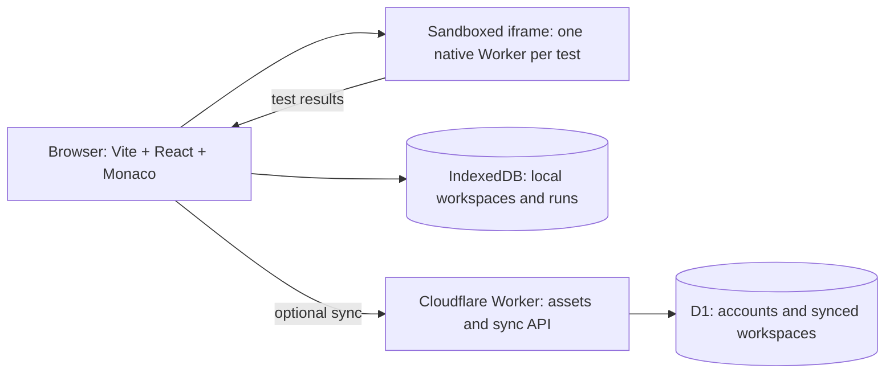

# Cloud DSA snippet practice workspace

Detailed contracts are in [specs/](specs/README.md); the step-by-step checklist is [TODO.md](TODO.md).

## Product target

Build a personal, cloud-synced DSA coding workspace. A user brings a problem or starts with a blank workspace, writes a JavaScript or TypeScript solution, creates tests, runs them, and returns to the work later. The home screen lists only the user's workspaces. There is no public problem catalog or discovery flow.

The editor is desktop-first. On a phone the app should let the user read a workspace, edit tests, and run them; full code editing on phones depends on the editor decision under **Open decisions**.

## MVP experience

1. **New workspace:** choose **Start from scratch** or **Import problem**. Scratch opens a blank editor with an optional title, a notes panel, and a configurable function name. The notes panel collapses and stays hidden while empty. Import creates the same workspace with the supplied statement, examples, starter code, and tests where available.
2. **Import formats:** paste problem text, or upload a Markdown or JSON file. Parse fields where possible and show a review screen before saving; any unrecognized text remains in the statement so nothing is silently lost. Pasted examples often use named arguments (`nums = [2,7,11,15], target = 9`); map them to positional arguments using the parameter order of the starter function, and ask on the review screen when the order is unclear. The JSON format is the same versioned schema used for export. A problem URL importer is a separate integration decision because sites expose different data and access rules.
3. **Practice editor:** a resizable statement/editor/test layout, Monaco editor, JavaScript/TypeScript mode, syntax highlighting, autocomplete, TypeScript diagnostics, Prettier formatting with format on save, light/dark theme, font-size control, keyboard shortcuts, and autosave. Include **Run tests**, **Reset code**, and a console/results panel. **Reset code** restores the workspace's starter source: the imported starter code, or for scratch workspaces a stub generated from the function name. Prompt before resetting unsaved work.
4. **Tests:** users add, edit, delete, and reorder cases. Each case supplies an array of JSON arguments and an expected JSON result; optional labels make edge cases easy to find. For in-place problems such as `moveZeroes` or `sortColors`, a case can instead compare argument N after the call. Run all or one test. Show pass/fail, actual versus expected, runtime, and bounded console/error output. Persist tests with the workspace.
5. **History:** save code revision snapshots on each run and on explicit save, keeping the most recent 20 per workspace, plus recent test runs and a simple pass count for each workspace. Optional GitHub sign-in syncs workspaces, tests, and revisions across devices; run results stay on the device.
6. **Backup:** export one or all workspaces as JSON, and import that file again. Local-only users depend on this, because browsers can clear IndexedDB (see **Local storage**).

The runner supports functions over JSON-compatible values: primitives, arrays, and plain objects. The user names the function to call, such as `twoSum` or `solve`. Imported starter code can be edited before the first run. Linked lists and binary trees use explicit per-test adapters. Design problems can call a sequence of methods on a class.

## Cloudflare architecture

| Part                   | Choice                                                                                                     | Reason                                                                                                                                                                                                                                                                                        |
| ---------------------- | ---------------------------------------------------------------------------------------------------------- | --------------------------------------------------------------------------------------------------------------------------------------------------------------------------------------------------------------------------------------------------------------------------------------------- |
| Frontend               | Evolve the existing Vite+ TypeScript starter into React with Monaco                                        | Gives a familiar coding editor and keeps the current project toolchain. Lazy-load Monaco on the practice route. Monaco does not support mobile browsers, which is why the editor is desktop-first.                                                                                            |
| Hosting and API        | Cloudflare Worker with Static Assets and `/api/*` routes                                                   | One deployment serves the UI and persistence endpoints.                                                                                                                                                                                                                                       |
| Local data             | IndexedDB                                                                                                  | Edits and tests work without a server request. Keep recent run results here.                                                                                                                                                                                                                  |
| Cloud sync             | D1 behind a Worker                                                                                         | Sync workspaces, tests, and revisions at save checkpoints for signed-in users.                                                                                                                                                                                                                |
| TypeScript compilation | `sucrase` type stripping on the page                                                                       | Solutions only need types removed, and sucrase is far smaller than the roughly 10 MB `esbuild-wasm` binary. Monaco supplies editor diagnostics. Fall back to `esbuild-wasm` only if sucrase misses syntax people actually write.                                                              |
| Execution              | A native Web Worker per test inside an opaque-origin sandboxed iframe with a strict CSP (chosen in step 0) | Runs at full engine speed, isolates storage and cookies through the opaque origin, blocks the network through CSP, and stops hung code with `Worker.terminate()`. QuickJS WebAssembly was 10–20× slower and crashed on recursion deeper than about 1 000 calls; see specs/runner-decision.md. |
| Auth                   | Optional GitHub OAuth with secure HTTP-only session cookie                                                 | Allows cross-device sync while scratch work stays available without sign-in.                                                                                                                                                                                                                  |

Running tests makes **no Cloudflare execution request**. Static asset requests are free, and D1 has a free allowance for light sync usage; the initial deployment can target Workers Free. This design targets code that uses the supplied function contract and standard JavaScript values. Node.js packages, filesystem access, and shell commands are outside that contract. A later service-worker cache can make the app available offline as well.

### Worker routing

Configure Static Assets with `not_found_handling = "single-page-application"` so client routes serve `index.html`, and `run_worker_first = ["/api/*"]` so API requests always reach the Worker. Use `@cloudflare/vite-plugin` for local development if it works under vite-plus; otherwise run `wrangler dev` beside `vp dev` and proxy `/api`.

## Run contract

The practice page sends current source, language, function name, and selected tests to the runner. TypeScript is stripped to JavaScript on the page. The runner starts a fresh Worker for each test and terminates it at the test's deadline. It invokes the named function with each case's arguments, captures bounded console output, and returns serialized actual values. The page compares those values with expected values and stores the result in IndexedDB. A parent-thread watchdog calls `Worker.terminate()` if the runner stops responding, then starts a new one for the next run.

**Finding the function:** run the source as a classic script and look the function up as a global binding, which covers `function twoSum`, `var twoSum = function…` (the LeetCode JavaScript starter), and `const`/`let` declarations. If the source uses `export`, transform it to CommonJS and read the function from `exports`. An `import` statement gets a clear "imports are not supported" result.

**Values across the boundary:** pass inputs as JSON. Serialize return values with tags for values that JSON would silently change (`undefined`, `NaN`, `Infinity`, `-Infinity`, `-0`), so `[1, undefined]` is not reported as `[1, null]`. Functions, `Map`, `Set`, class instances, and cyclic values get a distinct non-serializable result.

**Timeouts:** each test has its own deadline (default 2 seconds), and the whole run has a total cap. The watchdog fires at the total cap plus a grace period, which also covers work the runtime cannot interrupt, such as a long native `sort`.

Keep expected results and comparison rules outside the runner; pass only test inputs into it. Use deep equality for JSON values, with optional unordered outer arrays or numeric tolerance per case. A thrown error, timeout, non-serializable return value, invalid JSON test, or missing function receives a distinct, actionable result. Cap source size, test count, output size, and runtime memory to protect the browser tab. Use a new Worker for each test, since re-running code in the same Worker keeps its globals, so one case cannot change the next case's globals.

Tests are user-authored and visible. A green run means the solution passed the selected tests, not that it passed an unseen platform judge. The UI should use **Passed all 8 tests**, not **Accepted**.

Show elapsed time as local diagnostic information only. It varies by device and runtime and does not represent a LeetCode runtime ranking. Render imported statements as safe text/Markdown without executing embedded HTML.

Configure Monaco's TypeScript `lib` without DOM types, plus a small `console` declaration, so autocomplete does not suggest APIs the runner lacks. Format with Prettier, loaded on first use; `Mod+S` formats and saves a revision, while autosave and runs never reformat code.

## Data and sync

IndexedDB stores `workspaces`, `test_cases`, `revisions`, and recent `runs`. A workspace stores title, statement/notes, source language, function name, source, starter source, timestamps, and a sync revision. D1 stores `users`, `sessions`, and synced copies of workspaces/tests/revisions.

- **Sync unit:** sync a workspace and its tests as one document with one revision number, so a test edit and a code edit cannot half-apply. Revisions sync as append-only snapshots under the same cap.
- **Conflicts:** the client sends the revision it last saw. The server saves only when that matches the stored revision and otherwise returns `409` with the server copy. The UI then offers **Keep mine**, **Keep theirs**, or **Keep both** (duplicates the workspace).
- **Debounce:** sync at checkpoints (pause in typing, run, explicit save) rather than on every keystroke.
- **Deletes:** record tombstones so a workspace deleted on one device is not restored by another.
- **First sign-in:** ask whether to upload the local workspaces to the account. **Sign-out:** keep local data and stop syncing.
- **Multiple tabs:** take a Web Lock per workspace; a second tab on the same workspace opens read-only with an "editing in another tab" notice.

### Local storage

Call `navigator.storage.persist()` after the first saved workspace. Safari can clear script-writable storage, including IndexedDB, for sites the user has not visited in 7 days of browser use, so remind local-only users about export and sign-in.

### Auth security

The OAuth flow sends and checks a `state` value. The session cookie is `Secure`, `HttpOnly`, and `SameSite=Lax`. State-changing `/api/*` requests also check the `Origin` header. The GitHub client secret lives in a Worker secret.

## Delivery sequence

Add unit tests with `vp test` from step 0 onward, starting with the deep-equality comparator, value serialization, the runner harness, and the import parser.

### 0. Browser runner proof

- Run representative JavaScript and TypeScript DSA solutions through sucrase and both runner candidates: QuickJS WASM in a Web Worker, and a native Web Worker inside an opaque-origin sandboxed iframe with a strict CSP.
- Measure first-load time, repeated-run time, and memory use on desktop and a mid-range phone. Include O(n log n) solutions on inputs of 10⁵–10⁶ elements. Verify recursion, thrown errors, in-place mutation, and forced termination of `while (true)`. Check the sandboxed-iframe Worker in Safari early.

**Gate:** pick the runner. Common snippets behave correctly, large-input solutions finish well inside the default deadline, and the editor remains responsive during a hung run.

**Status (2026-10-27):** native runner chosen and passing in Chromium, Firefox and WebKit; the mid-range phone measurement is still to do. See specs/runner-decision.md.

### 1. Workspace shell

- Add React routes for **My workspaces**, **New workspace**, and **Practice**.
- Configure Worker Static Assets with SPA routing and `run_worker_first`, IndexedDB, local development, and a staging deployment. Confirm `@cloudflare/vite-plugin` works under vite-plus.
- Implement scratch creation, persistence of the workspace fields, JSON export, and JSON import.

**Gate:** create a blank workspace, export it, import the file, and reopen both with the same content.

### 2. Editor and tests

- Add Monaco, layout controls, JS/TS switching, Prettier formatting with format on save, diagnostics, autosave, reset, and keyboard shortcuts.
- Add a test case editor with JSON validation, the in-place argument option, and individual/all selection.
- Add the per-workspace Web Lock for multiple tabs.

**Gate:** a user can edit code and test cases, refresh the page, and continue without losing work.

### 3. Browser runner

- Build the chosen runner with lazy-loaded TypeScript stripping.
- Add runtime limits, per-test and total deadlines, parent watchdog, value serialization, result comparison, and error reporting.
- Verify correct, wrong, throwing, hanging, logging, non-serializable, and oversized-output snippets in desktop and mobile browsers. Benchmark first-run download/startup and large-array performance.

**Gate:** all cases produce a terminal result and failures identify the relevant test or execution error.

### 4. Problem import

- Add paste and Markdown import with field parsing, named-argument mapping, sample test extraction, and the review screen.

**Gate:** paste a LeetCode-style statement with examples, review it, and run the extracted tests without manual fixes to the arguments.

### 5. Accounts and finish

- Add optional GitHub sign-in, D1 sync with conflict handling and tombstones, revision history, responsive layout, and accessibility checks.
- Log sync errors. Run `vp check`, `vp test`, build, and end-to-end flows before production deployment.

**Gate:** a user can sign in on a second device and resume their workspace, tests, and saved code revisions; editing the same workspace on both devices produces the conflict prompt instead of a silent overwrite.

## Open decisions

- ~~**Editor:**~~ decided 2026-10-27: Monaco, desktop-first. On phones the code is read-only; tests can still be edited. Revisit CodeMirror 6 if editing code on a phone becomes a goal.
- Confirm whether **Import problem** should also accept a URL. A URL importer needs a source-specific adapter and must handle sites that restrict automated access.
- Consider tags, folders, and more sign-in options.

## Reference documentation

- [Workers Static Assets](https://developers.cloudflare.com/workers/static-assets/)
- [Workers Static Assets: single-page applications](https://developers.cloudflare.com/workers/static-assets/routing/single-page-application/)
- [Cloudflare Vite plugin](https://developers.cloudflare.com/workers/vite-plugin/)
- [Workers Static Assets billing](https://developers.cloudflare.com/workers/static-assets/billing-and-limitations/)
- [D1 pricing](https://developers.cloudflare.com/d1/platform/pricing/)
- [Sucrase](https://github.com/alangpierce/sucrase)
- [esbuild browser WebAssembly API](https://esbuild.github.io/api/#in-the-browser)
- [Web Worker termination](https://developer.mozilla.org/en-US/docs/Web/API/Worker/terminate)
- [StorageManager.persist()](https://developer.mozilla.org/en-US/docs/Web/API/StorageManager/persist)
- [Web Locks API](https://developer.mozilla.org/en-US/docs/Web/API/Web_Locks_API)
- [CodeMirror 6](https://codemirror.net/)
